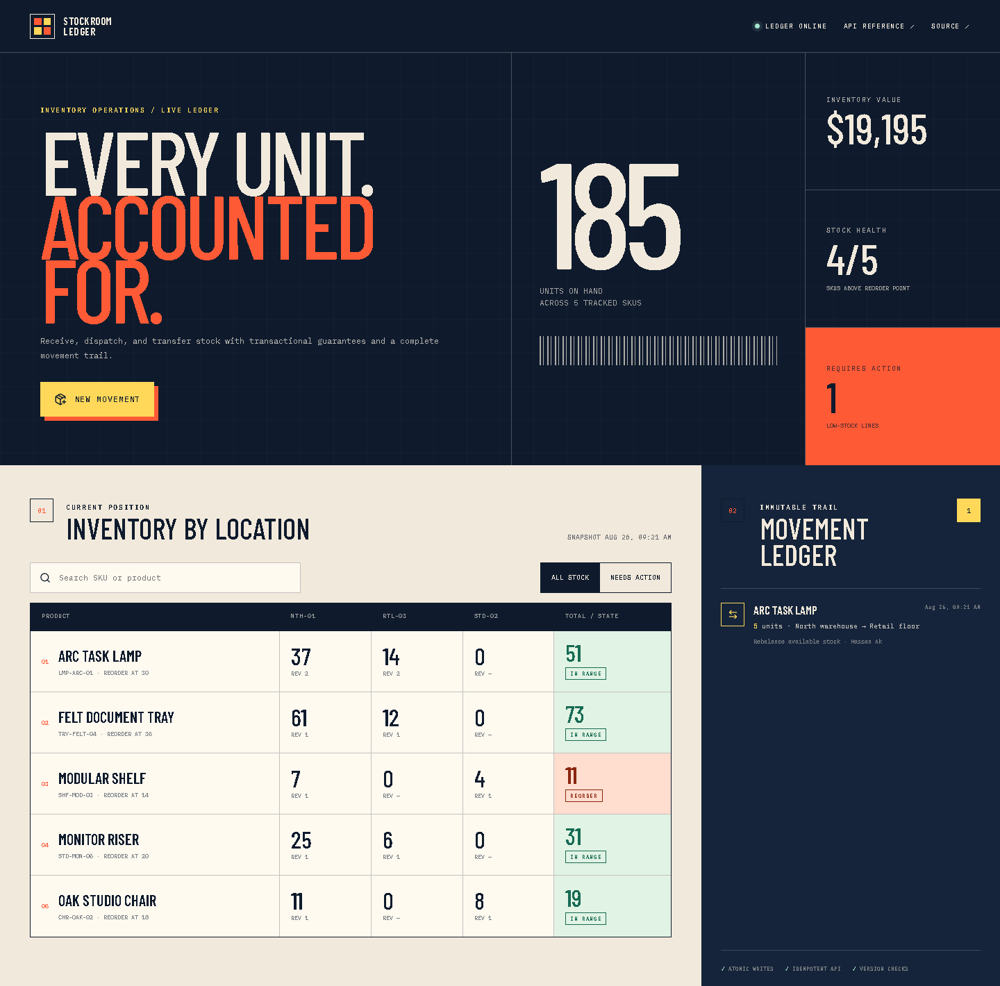

# Stockroom Ledger

[](https://github.com/kyan9400/stockroom-ledger/actions/workflows/ci.yml)
[](https://github.com/kyan9400/stockroom-ledger/releases/latest)
[](LICENSE)

A full-stack inventory operations console for receiving, dispatching, and transferring stock across locations without losing the audit trail.



## Why this project exists

Inventory demos are often CRUD tables with no meaningful consistency rules. Stockroom Ledger focuses on the failure cases that matter when quantities represent real goods:

- atomic multi-location transfers—both balances change or neither does;
- idempotency keys so retried requests do not duplicate a movement;
- optimistic version checks that reject writes from stale browser state;
- non-negative stock constraints and bounded request validation;
- an append-only movement ledger with actor, reason, route, and timestamp;
- integer currency and quantity storage to avoid rounding ambiguity;
- seeded data so the workflow can be evaluated immediately.

The interface makes these guarantees visible in the transaction panel and shows each location's current revision beside its balance.

## Run with Docker

```bash
docker compose up --build -d
curl -f http://127.0.0.1:8000/healthz
```

Open `http://127.0.0.1:8000`. The SQLite database is stored in the `stockroom-data` volume.

The container runs as UID 1001 with a read-only root filesystem, dropped Linux capabilities, `no-new-privileges`, a health check, and explicit CPU, memory, and process limits.

## API

Interactive OpenAPI documentation is available at `/docs`.

| Method | Route | Purpose |
|---|---|---|
| `GET` | `/api/dashboard` | Read metrics, inventory balances, locations, and recent movements |
| `POST` | `/api/movements` | Commit a receipt, dispatch, or transfer |
| `GET` | `/healthz` | Container and process health probe |

Every movement requires an `Idempotency-Key` header. A repeated key returns the original movement with `replayed: true` and does not change inventory twice.

```bash
curl -X POST http://127.0.0.1:8000/api/movements \
  -H 'Content-Type: application/json' \
  -H 'Idempotency-Key: receiving-note-2048' \
  -d '{
    "kind": "transfer",
    "productId": "prd-lamp",
    "fromLocationId": "loc-north",
    "toLocationId": "loc-retail",
    "quantity": 5,
    "reason": "Rebalance retail display stock",
    "actor": "Hassan Ak",
    "expectedSourceVersion": 1,
    "expectedDestinationVersion": 1
  }'
```

## Architecture

The repository keeps UI, HTTP, and persistence concerns separate:

```text
React + TypeScript
        │ same-origin JSON
        ▼
FastAPI routes + Pydantic contracts
        │
        ▼
transaction service ── idempotency / version / stock checks
        │
        ▼
SQLite WAL ── product / location / balance / movement
```

FastAPI serves the production frontend from the same origin, so the deployed application needs no permissive CORS policy. SQLite writes use `BEGIN IMMEDIATE` to serialize inventory mutations before validation and commit.

## Development

Requirements: Python 3.12+, Node.js 24+, and pnpm 11+.

```bash
# API
cd backend
python -m venv .venv
.venv/Scripts/python -m pip install -e ".[dev]"  # Windows
.venv/Scripts/uvicorn stockroom.main:app --reload

# UI, in another terminal
cd frontend
pnpm install
pnpm dev
```

Run the quality gates:

```bash
cd backend && ruff check src tests && ruff format --check src tests && pytest
cd frontend && pnpm lint && pnpm test && pnpm build
docker build -t stockroom-ledger:test .
```

Backend tests cover the seeded dashboard, atomic transfers, idempotent retries, insufficient-stock rollback, optimistic conflicts, validation, and security headers. Frontend tests cover rendering and the complete versioned movement request.

## Operations and rollback

Back up the `stockroom-data` volume before upgrading storage code. Releases are immutable tags, and the Compose file pins the application version.

To roll back, check out the previous release, rebuild, and verify the health endpoint before resuming writes:

```bash
git checkout v1.0.0
docker compose up --build -d --force-recreate
curl -f http://127.0.0.1:8000/healthz
```

## License

[MIT](LICENSE) © Hassan Ak

